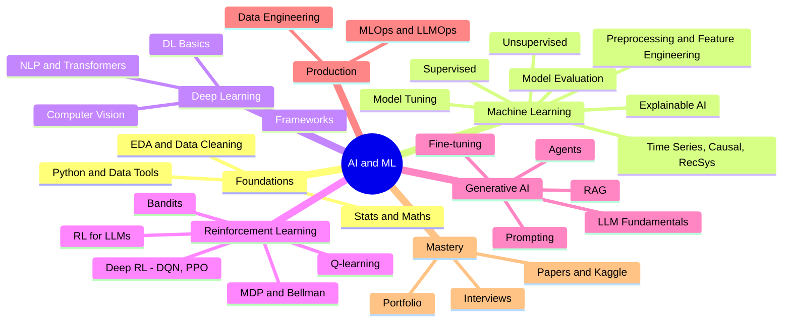

# 🗺️ AI & Machine Learning Roadmap: Mind-Map Edition

> I built this from your **"ML with Python" mind map** screenshots (2026-10-14). It keeps **every topic
> from your map**, fixes the mistakes in it, and adds the parts of modern AI the map was missing:
> EDA, explainable AI, time series, causal inference, **reinforcement learning**,
> **Generative AI / LLMs**, **MLOps**, and a career & mastery section.
>
> **How to use it:** go from top to bottom. Tick a box only when you can **explain the topic in
> your own words** and you have **used it in code at least once**.
>
> **Study loop for every topic:** ① learn the idea → ② do it by hand or from scratch →
> ③ use the library → ④ apply it to your own data → ⑤ explain it in your own words.

**Legend**
- 📌 = from your mind map
- ⭐ = new or better topic I added
- ✏️ = corrected from your mind map
- (no icon) = a basic topic that was hidden (collapsed) in your screenshots, or a short note

---

## 🧭 The big picture

---

## 🪜 Learning order

| Stage | What you learn | Sections | Time (about 2 hrs/day) |
|---|---|---|---|
| Start | AI landscape & ML lifecycle | §0 | 2–3 days |
| 0 | Maths & statistics | §1 | 3–4 weeks (can run alongside Stage 1) |
| 1 | Python & data tools | §2 | 2 weeks |
| 2 | EDA & data cleaning | §3 | 1 week |
| 3 | Preprocessing & feature engineering | §4 | 2 weeks |
| 4 | Supervised learning + evaluation + tuning | §5, §7, §8 | 4 weeks |
| 5 | Unsupervised learning + explainable AI | §6, §9 | 2 weeks |
| 6 | Time series, causal inference, survival, recommenders | §10 | 3 weeks |
| 7 | Deep learning basics + frameworks | §11, §14 | 3 weeks |
| 8 | Computer vision + NLP & Transformers | §12, §13 | 5 weeks |
| 9 | Reinforcement learning | §15 | 4 weeks |
| 10 | Generative AI & LLMs | §16 | 5 weeks |
| 11 | MLOps & data engineering | §17, §18 | 3 weeks |
| 12 | Mastery & career: papers, Kaggle, portfolio, interviews | §19 | ongoing |
| ★ | Projects ladder & capstone | Projects | build as you go |

> You already did part of Stages 3–4 in your 7-day program (regression, trees, forests, tuning).
> **Review those parts quickly. Don't start them again from zero.**

---

# PART A: Foundations

## 0. 🧭 Start here: The AI landscape & ML lifecycle

Your map starts at the tools. Before the tools, know the **big picture**.

- [ ] **AI vs Machine Learning vs Deep Learning vs Generative AI vs Data Science**: how they sit inside each other
- [ ] **Learning from data**: the model finds the patterns, you do not write the rules
- [ ] **Types of ML**: supervised, unsupervised, semi- / self-supervised, reinforcement (→ §15)
- [ ] **The ML project lifecycle**: frame the problem → get data → clean (§3) → features (§4) →
      train (§5) → evaluate (§7) → tune (§8) → deploy (§17) → monitor → retrain
- [ ] **Problem framing**: is ML even needed? A simple rule or a SQL query may be enough.
      What is the metric? What does a wrong answer cost?
- [ ] **Business metric vs model metric**: "fewer payroll errors" is the goal, "F1 score" is only a tool

🛠 **Mini-project:** write a 1-page note. Label 8 problems with their ML type: spam filter, house
price, customer groups, game-playing bot, chatbot, payslip anomaly, sales forecast, face login.
✅ **Done when:** you can explain the types of ML and the full lifecycle without notes.

---

## 1. 📐 Stats & Maths

📌 Your map had "Stats and Maths" collapsed. ⭐ This is the full branch.

- [ ] **Linear algebra**: the language of data and neural networks
  - [ ] Vectors, matrices, dot product, matrix multiplication *(one neural-network layer = one matrix multiply)*
  - [ ] Transpose, inverse, rank
  - [ ] Eigenvalues & eigenvectors *(the idea behind PCA)*
  - [ ] SVD *(used in PCA, recommenders, and LoRA)*
- [ ] **Calculus**: how models learn
  - [ ] Derivative, partial derivative, gradient
  - [ ] Chain rule *(this **is** backpropagation)*
  - [ ] Jacobian & Hessian (the idea only: matrices of derivatives)
  - [ ] Gradient descent
- [ ] **Probability**
  - [ ] Joint, marginal, conditional probability, independence
  - [ ] Bayes' theorem *(→ Naive Bayes)*
  - [ ] Distributions: Normal, Binomial, Poisson, Uniform
  - [ ] Expectation & variance
  - [ ] Law of large numbers & Monte Carlo sampling *(→ RL, §15.4)*
  - [ ] **Markov chains**: the next state depends only on the current state *(→ MDPs in RL, §15.2)*
  - [ ] Maximum likelihood (MLE): why we use these loss functions
- [ ] **Statistics**
  - [ ] Descriptive: mean, median, mode, std, percentiles, skewness
  - [ ] Sampling & the Central Limit Theorem
  - [ ] Hypothesis testing, p-value, confidence interval
  - [ ] t-test, chi-square test, ANOVA
  - [ ] A/B testing
  - [ ] Correlation vs causation
- [ ] ⭐ **Optimization**
  - [ ] Convex vs non-convex, local minima, saddle points
  - [ ] Gradient descent variants: batch, mini-batch, stochastic (SGD)
  - [ ] Constraints & Lagrange multipliers *(the idea behind SVM)*
  - [ ] Regularization as a "budget" on the weights (L1 / L2)
- [ ] ⭐ **Information theory**
  - [ ] Entropy *(→ decision-tree splits)*
  - [ ] Cross-entropy *(→ the classification loss)*
  - [ ] KL divergence *(→ VAEs, RLHF)*

🛠 **Mini-project:** (1) Gradient descent from scratch in NumPy. Fit a line and plot the loss going
down. (2) A/B test on your sales data: "Did a discount change the average order value?" Use a
t-test and explain the p-value in one sentence.
✅ **Done when:** you can explain *what a gradient is* and *what a p-value means* in simple words.

---

## 2. 🐍 Python & Data Tools

📌 Python & Libraries

- [ ] Python core: data types, functions, classes, comprehensions, `venv`
- [ ] **NumPy**: arrays, shapes, broadcasting, vectorization (why loops are slow)
- [ ] **Pandas**: select, filter, `groupby`, `merge`, `pivot_table`, missing data
- [ ] ⭐ **Polars**: a much faster DataFrame library (good to know)
- [ ] Visualization: Matplotlib, Seaborn, ⭐ Plotly (interactive charts)
- [ ] Jupyter notebooks, ⭐ Google Colab (free GPU for Part C)
- [ ] ⭐ **SQL**: `SELECT`, `JOIN`, `GROUP BY`, window functions
- [ ] ⭐ **Git & GitHub**: never commit data, models, or secrets

🛠 **Mini-project:** answer 5 business questions about your sales data **twice**, once with
Pandas and once with SQL (DuckDB), and check both answers match.
✅ **Done when:** you can load, filter, group, join, and plot any table without searching every line.

---

## 3. ⭐ EDA & Data Cleaning (new branch)

Your map jumped straight to preprocessing. In real jobs, **understanding and cleaning data comes first**.

- [ ] Understand the data: `shape`, `dtypes`, `describe()`, `value_counts()`
- [ ] Missing values: drop vs impute (mean / median / mode, `KNNImputer`, `IterativeImputer`)
- [ ] Duplicates and wrong types (dates stored as text, numbers stored as text)
- [ ] Outliers: IQR rule, z-score, box plot. Then decide: remove, cap, or keep
- [ ] Univariate plots: histogram, box plot, bar chart
- [ ] Bivariate / multivariate plots: scatter, correlation heatmap, pair plot
- [ ] Train / validation / test split: **split before you transform**
- [ ] **Data leakage**, the #1 beginner bug: information from the test set or from the future gets into training

🛠 **Mini-project:** clean your messy **Sales Order Report** Excel export, where order header rows,
item rows, and total rows are mixed together. Turn it into one tidy table with one row per item:
`order_no, date, customer, warehouse, item_code, qty, price, total`. Then make 5 useful charts.
✅ **Done when:** you can take any messy CSV/Excel file and produce a clean table + clear charts.

---

# PART B: Machine Learning

## 4. 🔧 Preprocessing & Feature Engineering 📌

### 4.1 Encoding & Binning 📌
- [ ] 📌 **Label Encoding**: for the target `y`. Avoid it for input features of linear models
- [ ] 📌 **One-Hot Encoding**: categories with no order (city, department)
- [ ] 📌 **Ordinal Encoding**: categories with an order (low < medium < high)
- [ ] 📌 **Binary Encoding**: many categories, fewer columns than one-hot
- [ ] 📌 **Frequency Encoding**: replace a category with how often it appears
- [ ] ⭐ **Target Encoding**: replace a category with the mean of the target (use CV to avoid leakage)
- [ ] ⭐ **Hashing**: for very many categories (e.g. thousands of item codes)
- [ ] ⭐ **Binning**: equal-width, equal-frequency (quantile), `KBinsDiscretizer`

### 4.2 Scaling & Transformation 📌
*(Your map had 6 items here; Log Transformation and PowerTransformer were visible.)*
- [ ] **StandardScaler**: mean 0, std 1 (for linear models, SVM, KNN, neural nets)
- [ ] **MinMaxScaler**: squash values into 0–1
- [ ] **RobustScaler**: uses median & IQR, safe with outliers
- [ ] **Normalizer**: scales each *row* (useful for text vectors)
- [ ] 📌 **Log Transformation**: fixes right-skewed data (salary, price)
- [ ] 📌 **PowerTransformer**: Box-Cox / Yeo-Johnson, makes data look more normal
- [ ] ⭐ **QuantileTransformer**: maps to a uniform or normal shape, robust to outliers
- [ ] 💡 Tree models (Random Forest, XGBoost) do **not** need scaling. Know *why*.

### 4.3 Text Processing 📌
- [ ] 📌 **Regex**: clean text, extract patterns (phone numbers, emails, item codes)
- [ ] 📌 **Tokenization**: split text into words
- [ ] ⭐ **Subword tokenization** (BPE, WordPiece): how BERT and GPT really split text
- [ ] 📌 **Stopwords Removal**
- [ ] 📌 **Stemming / Lemmatization**
- [ ] 📌 **POS Tagging**
- [ ] ⭐ **N-grams**: "not good" carries a different meaning than "good"
- [ ] 📌 **Vectorization**
  - [ ] 📌 Count (Bag of Words)
  - [ ] 📌 TF-IDF
  - [ ] 📌 Word2Vec · ⭐ GloVe, FastText
  - [ ] 📌 BERT embeddings
  - [ ] ⭐ **Sentence embeddings** (`sentence-transformers`): the base of semantic search & RAG

### 4.4 ✏️ Feature Selection (your map had these under "Dim Reduction")
Feature **selection** *keeps some of the original columns*. PCA is feature **extraction**: it
*creates new, mixed columns*. They are different ideas, so learn them separately.
- [ ] 📌 **Filter Methods**: correlation, variance threshold, ⭐ chi-square, ⭐ mutual information, ⭐ VIF (multicollinearity)
- [ ] 📌 **Wrapper Methods**: ⭐ RFE, forward / backward selection
- [ ] 📌 **Embedded Methods**: ⭐ Lasso (L1), tree feature importance

### 4.5 Feature Extraction (Dimensionality Reduction)
- [ ] 📌 **PCA**
- [ ] ⭐ **LDA (Linear Discriminant Analysis)**: the supervised version of PCA
- [ ] ⭐ **Truncated SVD**: for big sparse text matrices (TF-IDF)
- *(t-SNE and UMAP, which are for pictures of data, are in §6.)*

### 4.6 Feature Creation 📌
- [ ] 📌 **Mathematical Combinations**: ratios, differences (e.g. `overtime_pay / base_salary`)
- [ ] 📌 **Interaction Features**: feature A × feature B
- [ ] 📌 **Aggregations**: group statistics (e.g. average order value per customer)
- [ ] ⭐ **Date/time features**: day of week, month, holiday, hour
- [ ] ⭐ **Lag & rolling features**: last week's sales, 7-day average (time series)
- [ ] ⭐ **PolynomialFeatures**
- [ ] ⭐ **Domain features**: business knowledge turned into columns (e.g. late-arrival count per employee from biometric punches)

### 4.7 Imbalanced Dataset 📌
- [ ] 📌 **Undersampling**: random, ⭐ Tomek links, ⭐ NearMiss
- [ ] 📌 **Oversampling**: random, ⭐ SMOTE, ⭐ ADASYN
- [ ] ✏️ **SMOTE-Tomek** (your map says "SMOTTomek"): SMOTE oversampling + Tomek-links cleaning, combined
- [ ] ⭐ **Class weights**: `class_weight="balanced"`, no resampling needed
- [ ] ⭐ **Threshold tuning**: move the 0.5 cut-off
- [ ] ⚠️ Resample **only the training set**, never the test set

### 4.8 ⭐ Pipelines (no leakage)
- [ ] `Pipeline` + `ColumnTransformer`: every step is fitted on the training data only
- [ ] `FunctionTransformer` and custom transformers
- [ ] `imblearn.pipeline.Pipeline` (so SMOTE runs inside cross-validation)
- [ ] Save / load a fitted pipeline with `joblib`

### 4.9 Python Libraries for this branch 📌
| Library | Use it for |
|---|---|
| 📌 Pandas, 📌 NumPy | tables and arrays |
| 📌 NLTK / spaCy | text processing |
| 📌 imblearn (imbalanced-learn) | SMOTE, undersampling, imbalanced pipelines |
| 📌 statsmodels | statistical tests, classic regression, time series |
| 📌 scikit-learn | `preprocessing`, `feature_selection`, `pipeline`, `model_selection` |
| ⭐ category_encoders | Binary, Target, Hashing encoders |

🛠 **Mini-project:** one `Pipeline` for your HRM payslip data: impute → encode → scale → model,
with the rare "anomaly" class handled by SMOTE inside an `imblearn` pipeline.
✅ **Done when:** raw data → model-ready features in **one** pipeline, with no leakage.

---

## 5. 🎯 Supervised Learning 📌

### 5.1 Regression (predict a number) 📌
- [ ] 📌 Linear Regression
- [ ] 📌 Polynomial Regression
- [ ] 📌 Lasso (L1) / Ridge (L2)
- [ ] 📌 ElasticNet (L1 + L2)
- [ ] 📌 SVR
- [ ] 📌 KNN Regressor
- [ ] ⭐ Decision Tree Regressor
- [ ] 📌 Random Forest Regressor
- [ ] 📌 Boosting Regressors: XGBoost, LightGBM, CatBoost
- [ ] ⭐ Quantile regression: predict a *range* (low / high), not only one number
- [ ] ⭐ **Classic regression with statsmodels** 📌: the OLS summary (coefficients, p-values, confidence intervals, R²)
- [ ] ⭐ **Regression diagnostics**: residual plots, linearity, constant variance, multicollinearity (VIF)
- [ ] ⭐ **GLMs**: Poisson regression for counts (e.g. number of late arrivals), logistic regression as a GLM

### 5.2 Classification (predict a class) 📌
- [ ] 📌 Logistic Regression
- [ ] 📌 KNN Classifier
- [ ] 📌 SVC (⭐ kernels: linear, RBF)
- [ ] 📌 Naive Bayes (Gaussian; Multinomial for text)
- [ ] 📌 **Tree Based Models**
  - [ ] 📌 Decision Tree (Gini, entropy, pruning)
  - [ ] 📌 Random Forest
  - [ ] 📌 Extra Trees
  - [ ] 📌 Gradient Boosting Machines (GBM)
  - [ ] 📌 AdaBoost
  - [ ] 📌 XGBoost
  - [ ] 📌 LightGBM
  - [ ] 📌 CatBoost (handles categorical columns by itself)
- [ ] ⭐ Binary vs multi-class (One-vs-Rest, One-vs-One) vs multi-label

### 5.3 Ensemble Techniques 📌
- [ ] 📌 Bagging
- [ ] 📌 Boosting
- [ ] 📌 Stacking
- [ ] 📌 Voting Classifier (hard / soft voting)
- [ ] ⭐ Blending

### 5.4 ⭐ How to pick a model (cheat sheet)
| Situation | Try first |
|---|---|
| Always, before anything | A **baseline**: `DummyClassifier` / predict the mean |
| Tabular data, want the best score | LightGBM / XGBoost / CatBoost |
| Must explain to business people | Linear / Logistic Regression, a small Decision Tree |
| Small data, many features | Ridge / Lasso, SVM |
| Text with little data | TF-IDF + Logistic Regression or Naive Bayes |
| Images, audio, long text | Deep learning (§11–§13) |

🛠 **Mini-project:** compare 6+ models on one dataset (predict order total, or flag payslip
anomalies) with cross-validation. Put all results in **one table**.
✅ **Done when:** you can say which model you picked **and why**.

---

## 6. 🧩 Unsupervised Learning 📌 (expanded)

Your map had only Clustering and PCA. Here is the full branch:

- [ ] 📌 **Clustering**
  - [ ] K-Means (choose k with the elbow method and silhouette score)
  - [ ] ⭐ Hierarchical clustering (dendrogram)
  - [ ] ⭐ DBSCAN / HDBSCAN (finds any shape, marks noise)
  - [ ] ⭐ Gaussian Mixture Models (GMM): soft clusters
- [ ] **Dimensionality reduction**
  - [ ] 📌 PCA
  - [ ] ⭐ t-SNE, UMAP: 2-D pictures of high-dimensional data (and of embeddings)
- [ ] ⭐ **Anomaly detection**
  - [ ] Isolation Forest *(your HRM payslip project)*
  - [ ] Local Outlier Factor (LOF)
  - [ ] One-Class SVM
  - [ ] Autoencoders *(after §11)*
- [ ] ⭐ **Association rules**: Apriori / FP-Growth, "customers who buy X also buy Y"
- [ ] ⭐ **Evaluate without labels**: silhouette, Davies–Bouldin, plus a human sanity check

🛠 **Mini-project:** customer segmentation on your sales data: RFM features (recency, frequency,
monetary) + K-Means. Describe each group in one sentence. Then find item pairs that sell together.
✅ **Done when:** your clusters have a clear **business meaning**, not just numbers.

---

## 7. 📊 Model Evaluation 📌

- [ ] 📌 **Bias-variance tradeoff**: underfitting vs overfitting
- [ ] ⭐ **Learning curves & validation curves**: *see* over/underfitting in a chart
- [ ] ⭐ **Baselines**: always compare against a dummy model
- [ ] 📌 **Cross-validation**
  - [ ] 📌 K-Fold
  - [ ] 📌 Stratified K-Fold (keeps the class ratio in every fold)
  - [ ] 📌 LOOCV
  - [ ] 📌 Time Series Split (never train on the future)
  - [ ] ⭐ Group K-Fold (the same employee/customer is never in both train and test)
  - [ ] ⭐ Nested CV (an honest score while you also tune)
- [ ] 📌 **Confusion Matrix for Classification**: TP, FP, TN, FN. The base of every metric below
- [ ] 📌 **Classification metrics**
  - [ ] 📌 Accuracy. ⚠️ It lies on imbalanced data
  - [ ] 📌 Precision: "Of my alarms, how many were right?"
  - [ ] 📌 Recall: "Of the real cases, how many did I catch?"
  - [ ] 📌 F1 Score
  - [ ] ⭐ Multi-class averaging: macro, micro, weighted
  - [ ] 📌 ROC curve & AUC
  - [ ] ⭐ Precision-Recall curve & PR-AUC (better for rare classes)
  - [ ] ⭐ Log loss
  - [ ] ⭐ MCC (Matthews correlation coefficient)
  - [ ] ⭐ Calibration: is "80% sure" really right 80% of the time?
- [ ] 📌 **Regression metrics**
  - [ ] ✏️ **R²**: how much of the variation the model explains. *It is not accuracy, and it can be negative.*
  - [ ] ⭐ Adjusted R²
  - [ ] 📌 MSE · 📌 RMSE · 📌 MAE
  - [ ] ⭐ MAPE: error in %, which business people understand

---

## 8. 🎛️ Model Tuning 📌

- [ ] ⭐ Parameters (learned) vs hyperparameters (you set them)
- [ ] 📌 **Grid Search**
- [ ] 📌 **Random Search**
- [ ] ⭐ **Successive Halving** (`HalvingGridSearchCV`) / Hyperband: much faster
- [ ] 📌 **Bayesian Optimization**, ⭐ using **Optuna**
- [ ] 📌 **Genetic Algorithm** (e.g. TPOT)
- [ ] ⭐ **Early stopping** (boosting models & neural nets)
- [ ] ⭐ **AutoML**, for awareness: AutoGluon, FLAML

🛠 **Mini-project (§7 + §8):** take your best model from §5, tune it with Optuna, and write an
"evaluation report": confusion matrix, PR-AUC, nested-CV score, and a plain-English verdict.
✅ **Done when:** you never trust accuracy alone, and you can say **which metric fits which problem**.

---

## 9. ⭐ Explainable & Responsible AI (new branch)

- [ ] Built-in feature importance and ⭐ permutation importance
- [ ] **SHAP**: why did the model make *this* prediction?
- [ ] **LIME**
- [ ] Partial dependence plots (PDP) / ICE plots
- [ ] **Bias & fairness**: compare results per group (gender, department, branch)
- [ ] **Privacy**: personal data (salaries!), anonymization
- [ ] **Model cards**: write down what the model can and cannot do

🛠 **Mini-project:** add SHAP explanations to your HRM anomaly model, so each flag says *why*
(e.g. "flagged because overtime is 3× this employee's normal").
✅ **Done when:** you can explain any single prediction to a non-technical manager.

---

## 10. ⭐ Specialized ML: Time Series, Causal Inference, Survival & Recommenders (new branch)

### 10.1 Time series
- [ ] Trend, seasonality, noise (decomposition)
- [ ] Stationarity, differencing, ACF / PACF plots
- [ ] Classic models: ARIMA / SARIMA, Exponential Smoothing, Prophet
- [ ] ML approach: lag + rolling features → LightGBM
- [ ] Deep & foundation models, for awareness: LSTM, N-BEATS, Chronos, TimesFM
- [ ] **Backtesting** (walk-forward validation)

### 10.2 Recommender systems
- [ ] Popularity baseline, content-based, collaborative filtering
- [ ] Matrix factorization (SVD / ALS)
- [ ] Cold-start problem
- [ ] Metrics: precision@k, recall@k, NDCG

### 10.3 Causal inference & experiments
Prediction answers "what will happen?". Causal inference answers "**what if I change something?**"
- [ ] Correlation vs causation, **confounders**
- [ ] Randomized experiments (A/B tests): sample size, power, common mistakes (stopping early when the result looks good)
- [ ] When you cannot run an experiment: **propensity-score matching**, **difference-in-differences**
- [ ] **Uplift modeling**: find who is *helped* by a discount, not just who buys anyway
- [ ] Tools, for awareness: DoWhy, EconML, CausalML

### 10.4 Survival analysis (time-to-event)
- [ ] The problem: *when* will it happen (an employee leaves, a customer churns, a machine fails)?
- [ ] **Censoring**: some people have not left *yet*, and you must not throw them away
- [ ] Kaplan–Meier curve, Cox proportional-hazards model
- [ ] Tools: `lifelines`, `scikit-survival`

*(Reinforcement learning now has its own full branch → §15.)*

🛠 **Mini-projects:**
1. **Forecast** next month's sales per item from your Sales Order data, with walk-forward
   backtesting. Compare Prophet against LightGBM-with-lags.
2. **Causal:** "Did the discount really raise order value?" Compare the naive average difference
   with a matched comparison, and explain why they differ.
3. **Survival:** plot employee tenure curves by department (or customer churn curves by segment).

✅ **Done when:** you can forecast **without ever shuffling time**, and you can explain why
"customers with a discount spent more" does not prove the discount worked.

---

# PART C: Deep Learning

## 11. 🔥 Deep Learning Basics 📌

- [ ] 📌 ANN architecture / Neural network architecture
- [ ] 📌 Neuron, input & output layers, ✏️ hidden layers *(typo "Hideen" in the map)*
- [ ] 📌 **Activation functions**: ReLU, Sigmoid, Softmax, Swish, Tanh, Linear + ⭐ GELU (used in Transformers)
- [ ] 📌 **Loss functions**: Cross-Entropy, MSE / MAE + ⭐ Binary Cross-Entropy, Huber
- [ ] 📌 **Optimizers**: SGD, Adam, RMSprop + ⭐ Momentum, AdamW
- [ ] 📌 **Forward and backpropagation**
- [ ] 📌 **Epochs, batch size, learning rate** + ⭐ LR schedulers (step, cosine, warm-up)
- [ ] 📌 **Overfitting & regularization**: Dropout, L2 + ⭐ early stopping, data augmentation
- [ ] 📌 **Vanishing & exploding gradients** + ⭐ the fixes: ReLU, good init, residual connections, gradient clipping
- [ ] ⭐ **Weight initialization**: Xavier / Glorot, He
- [ ] ⭐ **Normalization layers**: BatchNorm, LayerNorm
- [ ] ⭐ **GPU training & mixed precision** (fp16 / bf16)
- [ ] ⭐ **Autoencoders**: compress & rebuild, also used for anomaly detection
- [ ] ⭐ **How to debug training**: first overfit one tiny batch; at the start the loss should be about
      ln(number of classes); watch the train vs validation curves; change one thing at a time
- [ ] ⭐ **Deep learning on tabular data**: when neural nets lose to XGBoost, and why (TabNet, FT-Transformer, for awareness)
- [ ] ⭐ **Self-supervised & contrastive learning**: learn from data without labels (SimCLR, masked autoencoders). The idea behind foundation models
- [ ] ⭐ **Training at scale** (awareness): gradient accumulation, data parallel (DDP), FSDP / DeepSpeed
- [ ] ⭐ **Other architectures** (awareness): graph neural networks (GNN), state-space models (Mamba), Mixture-of-Experts

🛠 **Mini-project:** a 2-layer neural net **from scratch in NumPy** on MNIST (write backprop
yourself), then rebuild it in PyTorch and in Keras.
✅ **Done when:** you can write a PyTorch training loop from memory and explain backprop.

---

## 12. 👁️ Computer Vision (Image / Video) 📌

*(Your map had 12 items here; only "Image Classification using CNN" was open in the screenshots.)*

- [ ] ⭐ **Image basics**: pixels, RGB channels, resizing, OpenCV
- [ ] 📌 **Image Classification using CNN**
  - [ ] 📌 Raw pixels: why a plain neural net is not enough
  - [ ] 📌 CNNs (backbone): convolution, filters, stride, padding, pooling, feature maps
  - [ ] 📌 Pretrained CNNs: LeNet, AlexNet, 📌 VGG, 📌 ResNet, Inception, MobileNet, EfficientNet, ⭐ ConvNeXt
  - [ ] ✏️ **ImageNet is a dataset** (~14M labeled images), not a model. The models above are *pretrained on* ImageNet.
- [ ] ⭐ **Transfer learning & fine-tuning**: freeze vs unfreeze layers
- [ ] ⭐ **Data augmentation**: flip, crop, rotate, color jitter
- [ ] ⭐ **Object detection**: bounding boxes, IoU, NMS, mAP; YOLO, Faster R-CNN, DETR
- [ ] ⭐ **Segmentation**: U-Net (semantic), Mask R-CNN (instance), SAM (Segment Anything)
- [ ] ⭐ **Vision Transformers (ViT)**
- [ ] ⭐ **CLIP**: images and text in one space (search images with words)
- [ ] ⭐ **OCR & document AI**: Tesseract, PaddleOCR, layout models (invoices, payslips!)
- [ ] ⭐ **Video**: frame sampling, 3D CNNs, object tracking, action recognition
- [ ] ⭐ **Generative vision**: VAE, GAN, Diffusion models (full details in §16.9)

🛠 **Mini-project:** fine-tune a pretrained model to classify documents (payslip / invoice / ID),
then use OCR to extract the total amount.
✅ **Done when:** you can fine-tune a pretrained vision model on your own images.

---

## 13. 📝 NLP (Text) 📌

- [ ] 📌 **Text Processing**: see §4.3
- [ ] 📌 **Sequence Models**
  - [ ] 📌 RNNs
  - [ ] 📌 LSTMs
  - [ ] 📌 GRUs
  - [ ] ⭐ Seq2Seq (encoder–decoder) + attention: the bridge to Transformers
- [ ] ✏️ ⭐ **Transformers**: your map put BERT under Sequence Models, but BERT is a
      Transformer. Transformers use **self-attention, not recurrence**, and they replaced RNNs.
  - [ ] Self-attention, multi-head attention, positional encoding
  - [ ] Encoder-only: 📌 **BERT**, RoBERTa (understanding text)
  - [ ] Decoder-only: GPT, Llama, Claude-style LLMs (generating text)
  - [ ] Encoder–decoder: T5, BART (translation, summarization)
- [ ] 📌 **Core Text Tasks**
  - [ ] 📌 Text Classification
  - [ ] 📌 Sentiment Analysis
  - [ ] ⭐ Named Entity Recognition (NER)
  - [ ] ⭐ Question Answering
  - [ ] ⭐ Summarization
  - [ ] ⭐ Translation
  - [ ] ⭐ Topic modeling (Latent Dirichlet Allocation, BERTopic)
  - [ ] ⭐ Semantic search / text similarity
- [ ] ⭐ **Hugging Face**: `transformers`, `datasets`, `tokenizers`, `Trainer`, Model Hub

🛠 **Mini-project:** fine-tune BERT for a text-classification task (e.g. sort HR questions into
"leave / payroll / attendance / other") and publish it on the Hugging Face Hub.
✅ **Done when:** you can explain self-attention and fine-tune a Hugging Face model.

---

## 14. 🧰 Libraries & Frameworks 📌

- [ ] ⭐ **PyTorch**: used by most research and new LLM work. **Learn it first.**
- [ ] 📌 **TensorFlow**: still in many company job posts
- [ ] 📌 **Keras**: Keras 3 runs on TensorFlow, PyTorch, or JAX
- [ ] ⭐ **Hugging Face**: `transformers`, `datasets`, `peft`, `accelerate`
- [ ] ⭐ PyTorch Lightning: less boilerplate (optional)
- [ ] ⭐ ONNX / ONNX Runtime: export a model and run it fast anywhere
- [ ] ⭐ TensorBoard / Weights & Biases: watch training live
- [ ] ⭐ JAX, for awareness only

🛠 **Mini-project:** train the same small image classifier with PyTorch (manual loop), Keras
(`model.fit`), and the Hugging Face `Trainer`. Write down what each one hides from you.
✅ **Done when:** you can start a new project in PyTorch without a tutorial, and you can read
Keras / TensorFlow code in a company codebase.

---

# PART D: Reinforcement Learning

## 15. 🎮 ⭐ Reinforcement Learning (new full branch)

**What it is:** in supervised learning, a teacher gives the right answer. In RL there is no
answer, only a **reward**. An **agent** tries actions in an **environment**, gets rewards, and
learns by trial and error which actions bring the most reward over time.

**Why learn it:** it runs game AI (AlphaGo), robotics, ads and recommendations, and, most
important today, the way **LLMs are trained** to follow instructions and to reason (RLHF, GRPO).
§15.8 is the bridge to Part E.

**Before you start:** §1 (probability, expectation), §11 (neural nets), §14 (PyTorch).

### 15.1 Core ideas
- [ ] **Agent, environment, state, action, reward, episode**
- [ ] **Policy** π: the agent's strategy, "in this state, do this action"
- [ ] **Return** & **discount factor γ**: a reward now is worth more than a reward later
- [ ] **Value function** V(s): how good a state is · **Q-function** Q(s, a): how good an action is in a state
- [ ] **Exploration vs exploitation**: try new actions, or use the best one you know?
- [ ] RL vs supervised learning: no labels, delayed rewards, and *your actions change your data*
- [ ] The RL family map:
  - [ ] model-free vs model-based
  - [ ] value-based vs policy-based vs actor-critic
  - [ ] on-policy vs off-policy
  - [ ] online vs offline

### 15.2 The maths of RL
- [ ] **Markov Decision Process (MDP)**: states, actions, transition probabilities, rewards
- [ ] **Bellman equation** (expectation and optimality): the most important equation in RL
- [ ] **Dynamic programming**: policy evaluation, policy iteration, value iteration
- [ ] POMDP (when the agent can't see the full state), for awareness

### 15.3 Multi-armed bandits (the simplest RL)
- [ ] The problem: many slot machines, which one pays best?
- [ ] ε-greedy, UCB (Upper Confidence Bound), Thompson sampling
- [ ] **Contextual bandits**: choose the best action *for this user*. Used in ads, recommendations, and smarter A/B tests

### 15.4 Classic (tabular) RL
- [ ] Monte Carlo methods: learn from complete episodes
- [ ] **Temporal-Difference (TD) learning**: learn after every step
- [ ] **SARSA** (on-policy)
- [ ] **Q-learning** (off-policy)
- [ ] ε-greedy exploration with decay
- [ ] Function approximation: why a Q-table breaks for big problems, which is why we need deep RL

### 15.5 Deep RL: value-based
- [ ] **DQN (Deep Q-Network)**: a neural net predicts Q-values
- [ ] **Experience replay** and **target network**: the two tricks that make DQN stable
- [ ] Improvements: Double DQN, Dueling DQN, Prioritized replay, Rainbow (awareness)

### 15.6 Deep RL: policy-based & actor-critic
- [ ] **Policy gradient** idea and **REINFORCE**
- [ ] Baselines & the **advantage function**: reduce noise in learning
- [ ] **Actor-Critic** (A2C / A3C): the actor picks actions, the critic judges them
- [ ] **GAE** (Generalized Advantage Estimation)
- [ ] **PPO (Proximal Policy Optimization)**: the default algorithm today, also used in RLHF
- [ ] Continuous actions (robot arms, steering): DDPG, TD3, **SAC**

### 15.7 Advanced RL (awareness)
- [ ] **Model-based RL**: learn a model of the world and plan inside it (MuZero, Dreamer)
- [ ] **Offline RL**: learn only from logged data, no live trial and error (CQL, Decision Transformer)
- [ ] **Imitation learning**: behavior cloning, inverse RL (learn the reward from an expert)
- [ ] **Multi-agent RL** and **self-play** (AlphaGo / AlphaZero)
- [ ] **Reward shaping** and **reward hacking** (the agent "cheats" the reward)
- [ ] Safe RL; sim-to-real for robotics

### 15.8 ⭐ RL for LLMs (the bridge to Part E)
- [ ] **RLHF**: SFT model → train a **reward model** on human preference pairs → optimize with **PPO** + a KL penalty (so the model doesn't drift too far)
- [ ] **DPO** (Direct Preference Optimization): learn from preference pairs **without** a reward model or an RL loop
- [ ] **RLAIF / Constitutional AI**: AI feedback instead of human feedback
- [ ] **GRPO** (Group Relative Policy Optimization): PPO without a critic. Introduced in DeepSeekMath and used for DeepSeek-R1
- [ ] **RLVR** (RL with verifiable rewards): reward = "is the maths answer correct?" or "do the code tests pass?" This is how **reasoning models** are trained
- [ ] Reward hacking in LLMs (e.g. long answers that *look* good to the reward model)
- [ ] Tool: Hugging Face **TRL** (`DPOTrainer`, `GRPOTrainer`, `PPOTrainer`)

### 15.9 Evaluating & debugging RL
- [ ] Reward curves (episode return over training), **averaged over several random seeds**
- [ ] Always compare against a **random agent** and a **simple rule-based** agent
- [ ] Why RL is hard: unstable training, very sensitive to hyperparameters, hard to reproduce
- [ ] Watch the agent play (record videos). Numbers alone can hide reward hacking

### 15.10 Tools
- [ ] **Gymnasium**: standard environments (CartPole, FrozenLake, LunarLander, Atari)
- [ ] **Stable-Baselines3**: reliable ready-made algorithms (DQN, PPO, SAC)
- [ ] **CleanRL**: each algorithm in one readable file, great for learning
- [ ] **TRL**: RL for LLMs
- [ ] PettingZoo (multi-agent), Ray RLlib (scale), MuJoCo (robotics simulation), for awareness

🛠 **Mini-projects (in this order):**
1. **Q-learning from scratch in NumPy** on FrozenLake and Taxi. Plot the reward curve.
2. **Contextual bandit on your sales data**: a simulated "which discount to offer to which
   customer type" problem. Compare ε-greedy vs Thompson sampling against a fixed-discount rule.
3. **DQN from scratch in PyTorch** on CartPole, then compare with Stable-Baselines3's DQN.
4. **PPO on LunarLander** with Stable-Baselines3. Record a video of the landing.
5. **Bridge to LLMs:** DPO fine-tune a small open LLM with TRL on ~500 preference pairs, then
   compare its answers before and after.

✅ **Done when:** you can explain the Bellman equation, the difference between **Q-learning and
policy gradients**, and how **RLHF, DPO, and GRPO** use RL ideas to train LLMs.

📚 **RL resources:** Sutton & Barto, *Reinforcement Learning: An Introduction* (2nd ed., free
online) · David Silver's RL course (YouTube) · OpenAI *Spinning Up in Deep RL* · Hugging Face
*Deep RL Course* (free) · CleanRL code.

---

# PART E: Generative AI & LLMs

## 16. 🤖 ⭐ Generative AI & LLMs (new branch, the biggest addition)

### 16.1 LLM fundamentals
- [ ] Tokens & tokenizers, context window
- [ ] Next-token prediction; sampling with temperature, top-p, top-k
- [ ] Training stages: pretraining → instruction tuning (SFT) → preference tuning (RLHF / DPO / GRPO, see §15.8)
- [ ] Reasoning models: models that "think" step by step before answering
- [ ] ⭐ **LLM architecture & scaling**: the decoder-only Transformer block, KV cache, RoPE positions, FlashAttention, Mixture-of-Experts, scaling laws (awareness)
- [ ] Hallucination: why it happens
- [ ] Open vs closed models; choosing a model (quality vs cost vs speed)

### 16.2 Prompt engineering
- [ ] System prompts, roles, clear instructions
- [ ] Zero-shot and few-shot examples
- [ ] Step-by-step reasoning prompts
- [ ] **Structured output** (JSON schema)
- [ ] Prompt templates & versioning
- [ ] ⭐ **Context engineering**: decide what goes into the context window (instructions, retrieved documents, tool results, memory) and what stays out

### 16.3 Embeddings & vector databases
- [ ] Text embeddings, cosine similarity
- [ ] Vector DBs: FAISS, Chroma, **pgvector**, Qdrant
- [ ] Approximate nearest-neighbour indexes (HNSW), for awareness

### 16.4 RAG (Retrieval-Augmented Generation)
- [ ] Document loading & chunking strategies
- [ ] Retrieval: dense (embeddings), keyword (BM25), **hybrid**
- [ ] Reranking
- [ ] Answers **with citations**
- [ ] Advanced: query rewriting, metadata filters, GraphRAG (awareness)
- [ ] **RAG evaluation**: retrieval hit rate, faithfulness, answer relevance (e.g. RAGAS)

### 16.5 AI agents
- [ ] **Tool calling / function calling** *(you already built one in `hrm_app/`)*
- [ ] The agent loop: think → act → observe (ReAct)
- [ ] **MCP (Model Context Protocol)**: the standard way to connect tools & data to LLMs
- [ ] Memory (short-term, long-term) and planning
- [ ] Multi-agent systems
- [ ] Frameworks: Claude Agent SDK, LangGraph, OpenAI Agents SDK. **Pick one and learn it deeply.**
- [ ] ⭐ **Evaluate agents**: task success rate, correct tool calls, number of steps, cost
- [ ] ⭐ Computer-use / browser agents and agent-to-agent protocols (A2A), for awareness
- [ ] Guardrails and human-in-the-loop for risky actions

### 16.6 Fine-tuning
- [ ] When to use **prompting vs RAG vs fine-tuning**
- [ ] Full fine-tuning vs PEFT
- [ ] **LoRA, QLoRA**
- [ ] Preparing an instruction dataset
- [ ] Tools: Hugging Face `peft`, `trl`, Unsloth

### 16.7 Running models locally & efficiently
- [ ] Quantization (8-bit, 4-bit, GGUF)
- [ ] Ollama, llama.cpp (laptop) · vLLM (server)
- [ ] Distillation, for awareness

### 16.8 Multimodal & speech
- [ ] Vision-language models: ask questions about images and PDFs
- [ ] ⭐ **Audio basics**: waveform, sampling rate, spectrogram, mel-spectrogram, MFCC
- [ ] **Speech-to-text (ASR)**: Whisper, wav2vec 2.0
- [ ] **Text-to-speech (TTS)**, voice cloning (and how it can be misused)
- [ ] Speaker diarization ("who spoke when"), for awareness
- [ ] **Voice agents**: speech-to-text → LLM → text-to-speech, and keeping latency low

### 16.9 ⭐ Generative models for images, audio & video
- [ ] **Autoencoder → VAE**: a latent space you can sample new data from
- [ ] **GAN**: generator vs discriminator, mode collapse, and why diffusion replaced GANs for most uses
- [ ] **Diffusion models**: add noise step by step, learn to remove it (DDPM); **latent diffusion** (Stable Diffusion); classifier-free guidance
- [ ] Control & customization: ControlNet, LoRA for images, image-to-image, inpainting
- [ ] Flow matching and text-to-video, for awareness
- [ ] Evaluation: FID, CLIP score, and human judgment
- [ ] Tools: Hugging Face `diffusers`, ComfyUI (awareness)
- [ ] Ethics: deepfakes, copyright, watermarking

### 16.10 LLM evaluation, safety & cost
- [ ] Eval sets (golden Q&A pairs), automated prompt tests
- [ ] LLM-as-a-judge
- [ ] **Prompt injection** and data leakage
- [ ] Hallucination & groundedness checks
- [ ] Cost & latency: prompt caching, batching, streaming, smaller models for easy tasks

🛠 **Mini-projects (in this order):**
1. **Tiny GPT from scratch** (Karpathy's "Let's build GPT" / nanoGPT) on a small text file.
   Watch the loss go down and the generated text get better. *(needs §13)*
2. **RAG assistant over HR policy documents** that answers with citations, tested on an eval
   set of 30 questions.
3. **Agent**: extend project 2 so it can also query payslip data through tools.
4. **Text-to-SQL assistant over your sales database**: the LLM turns "top 5 customers last
   month?" into SQL, runs it **read-only** (guardrails: allow-list of tables, no writes), and
   explains the result.
5. **LoRA fine-tune** a small open model on a tiny dataset, and compare it against plain
   prompting on the same questions.
6. **Streaming chat UI**: FastAPI with server-sent events (SSE) + the Next.js skills from `hrm_app/`.

✅ **Done when:** you can build RAG + an agent, and explain *when to prompt, retrieve, or fine-tune*.

---

# PART F: Production

## 17. ⚙️ ⭐ MLOps & LLMOps (new branch)

- [ ] **Experiment tracking**: MLflow, Weights & Biases
- [ ] **Data & model versioning**: DVC, model registry
- [ ] **Serving**: FastAPI *(your strength)*, BentoML; batch vs real-time
- [ ] **Docker** & docker-compose; Kubernetes, for awareness
- [ ] ⭐ **Deployment patterns**: shadow mode, canary release, A/B test between two models, quick rollback
- [ ] ⭐ **Security basics**: secrets management, API keys, rate limits, input validation
- [ ] **CI/CD**: GitHub Actions (test → build → deploy)
- [ ] **Testing ML code**: pytest, data validation (Pandera / Great Expectations)
- [ ] **Monitoring**: latency, errors, **data drift**, model drift (Evidently)
- [ ] **Retraining pipelines**; orchestration with Airflow / Prefect
- [ ] **Cloud basics**: one of AWS SageMaker / GCP Vertex AI / Azure ML; Hugging Face Spaces for demos
- [ ] **LLMOps**: tracing (Langfuse / LangSmith), prompt versioning, cost tracking, evals in CI

## 18. 🗄️ ⭐ Data Engineering Essentials (new branch)

- [ ] SQL for ML: joins, window functions, CTEs
- [ ] ETL / ELT pipelines; batch vs streaming
- [ ] DuckDB and Parquet files (fast local analytics)
- [ ] Spark, for awareness (big data)
- [ ] Feature stores, the concept (e.g. Feast)
- [ ] Data quality checks

🛠 **Mini-project (§17 + §18):** take any earlier model, then track its training in MLflow, serve
it with FastAPI, put it in Docker, deploy it, and add a drift report.
✅ **Done when:** you have a **live URL** with a monitored model behind it.

---

# PART G: Mastery & Career

## 19. 🏆 ⭐ Mastery & Career (new branch)

Knowing the topics is not enough. This is how you **prove** it and keep growing.

- [ ] **Read research papers**: pass 1 = title, abstract, figures; pass 2 = method; pass 3 = details.
      Find papers on arXiv and Hugging Face Daily Papers. Start with: *Attention Is All You Need*,
      BERT, ResNet, LoRA, InstructGPT (RLHF), DPO, and the DeepSeek-R1 paper (GRPO)
- [ ] **Re-implement one paper** in a small version (for example a tiny Transformer or a small ResNet)
- [ ] **Kaggle**: finish 2 tabular competitions, then read the top solutions and learn what you missed
- [ ] **GitHub portfolio**: for each project, a clean README (problem, data, approach, results,
      how to run), a live demo link, a short demo video, and **no secrets or private data**
- [ ] **Write**: 3 blog posts that explain a topic in simple words (writing proves understanding)
- [ ] **ML system design**: practise framing a problem → data → model → serving → monitoring →
      cost. Do 5 designs: fraud detection, recommender, RAG chatbot, demand forecasting, document OCR
- [ ] **Interview prep**: ML fundamentals (bias-variance, metrics, regularization), Python / pandas /
      SQL coding, and explaining your own projects in 2 minutes
- [ ] **Open source**: make one small pull request to a library you use (even a docs fix counts)
- [ ] **Stay current without burning out**: pick 2–3 sources (a newsletter, release notes, arXiv
      digests). Learn the fundamentals once, and follow the news lightly
- [ ] **Responsible practice**: protect personal data (salaries!), follow your country's data rules,
      know the idea of AI regulation (for example the EU AI Act), and document model limits

🛠 **Mini-project:** finish the capstone with a proper README, a demo video, and one blog post.
✅ **Done when:** a stranger can open your GitHub, understand a project, and run it in 10 minutes.

---

## ✏️ Corrections to your mind map

| In your map | Correct version | Why it matters |
|---|---|---|
| "SMOTTomek" | **SMOTE-Tomek** (`SMOTETomek` in imblearn) | SMOTE oversamples the rare class, then Tomek links clean the border |
| Dim Reduction = PCA + Filter + Wrapper + Embedded | Two topics: **Feature Selection** (filter / wrapper / embedded) and **Feature Extraction** (PCA) | Selection keeps original columns (easy to explain); extraction makes new mixed columns |
| "R-Squared (Accuracy)" | **R² = share of variance explained** | Accuracy is a classification metric; R² can even be negative |
| BERT under Sequence Models (with RNN / LSTM / GRU) | **BERT is a Transformer** (encoder-only) | Transformers use attention, not recurrence |
| ImageNet under Pretrained CNNs | **ImageNet is a dataset** | VGG / ResNet are *pretrained on* ImageNet |
| Library/Frameworks: Keras, TensorFlow | Add **PyTorch** and **Hugging Face** | Most research and new LLM work uses PyTorch |
| Unsupervised: Clustering, PCA | Add anomaly detection, association rules, DBSCAN / GMM, t-SNE / UMAP | Your own HRM project *is* anomaly detection |
| "Hideen Layers" | Hidden layers | typo |
| No overview, causal / survival, RL, GenAI, MLOps, or career branches | Added §0, §10.3–§10.4, §15–§19 | These are where most AI jobs are today, and RL is how modern LLMs learn to reason |

---

## 🏗️ Projects ladder

Build these as you finish each stage. Each one reuses your own data, so they add up to a real portfolio.

| # | Project | Uses | Your domain |
|---|---|---|---|
| 1 | Clean the messy Sales Order Report into a tidy table + EDA charts | §2–§3 | Sales |
| 2 | Sales forecasting (lags + LightGBM vs Prophet), walk-forward backtest | §4, §5, §7, §10 | Sales |
| 3 | Customer segmentation (RFM + K-Means) + "bought together" rules | §6 | Sales |
| 4 | "Did the discount work?" causal analysis + employee tenure survival curves | §10.3–§10.4 | Sales / HRM |
| 5 | HRM payslip anomaly detector with SHAP explanations | §4, §6, §9 | HRM |
| 6 | Document classifier + OCR (payslip / invoice / ID) | §12 | HRM |
| 7 | Fine-tuned BERT (or a LoRA small LLM) published on the Hugging Face Hub | §13, §16.6 | HR text |
| 8 | Tiny GPT from scratch | §13, §16.1 | Learning |
| 9 | RL agents: discount-offer bandit on sales data + PPO LunarLander + DPO-tuned small LLM | §15 | Sales / LLMs |
| 10 | Text-to-SQL assistant over your sales database (read-only, with guardrails) | §16.5 | Sales |
| 11 | RAG assistant over HR policy docs (scanned PDFs too, via OCR), with citations & an eval set | §16 | HRM |
| 12 | Streaming chat app: FastAPI (SSE) + Next.js frontend | §16, §17 | `hrm_app/` |
| 13 | 🏆 **Capstone: Intelligent HRM Assistant**: anomaly model + RAG explanations + tool-using agent, served with FastAPI + Docker, deployed and monitored | §16–§17, §19 | `hrm_app/` |

Full project specs and extra GenAI portfolio ideas: [ai_ml_engineer_pipeline.md](ai_ml_engineer_pipeline.md).

---

## ✅ Progress tracker

- [ ] 0. Start here: AI landscape & ML lifecycle
- [ ] 1. Stats & Maths
- [ ] 2. Python & Data Tools
- [ ] 3. EDA & Data Cleaning
- [ ] 4. Preprocessing & Feature Engineering
- [ ] 5. Supervised Learning
- [ ] 6. Unsupervised Learning
- [ ] 7. Model Evaluation
- [ ] 8. Model Tuning
- [ ] 9. Explainable & Responsible AI
- [ ] 10. Time Series, Causal Inference, Survival & Recommenders
- [ ] 11. Deep Learning Basics
- [ ] 12. Computer Vision
- [ ] 13. NLP & Transformers
- [ ] 14. Libraries & Frameworks
- [ ] 15. Reinforcement Learning
- [ ] 16. Generative AI & LLMs
- [ ] 17. MLOps & LLMOps
- [ ] 18. Data Engineering Essentials
- [ ] 19. Mastery & Career
- [ ] 🏆 Capstone

---

## 📚 Resources

- **Maths & stats:** 3Blue1Brown (YouTube): *Essence of Linear Algebra*, *Neural Networks* ·
  **StatQuest** (Josh Starmer), stats & ML explained in very simple English
- **Machine learning:** scikit-learn user guide · *Hands-On Machine Learning* (Aurélien Géron, 3rd ed.)
- **Deep learning:** [d2l.ai](https://d2l.ai) (free book) · Andrej Karpathy's *Neural Networks: Zero to Hero* · fast.ai
- **Reinforcement learning:** Sutton & Barto (free book) · David Silver's course · OpenAI
  *Spinning Up* · Hugging Face *Deep RL Course* (more in §15)
- **LLMs:** Hugging Face free courses · Anthropic & OpenAI docs ·
  *Build a Large Language Model (From Scratch)* (Sebastian Raschka)
- **MLOps:** *Made With ML* (Goku Mohandas) · DataTalksClub *MLOps Zoomcamp* (free)
- **Causal inference:** *Causal Inference for the Brave and True* (Matheus Facure, free online)
- **System design & career:** *Designing Machine Learning Systems* (Chip Huyen) · arXiv ·
  Hugging Face Daily Papers · Kaggle

## 🔗 Companion notes

- Theory depth per phase → [advanced_ai_roadmap.md](advanced_ai_roadmap.md)
- 20-chapter curriculum + full project specs → [ai_ml_engineer_pipeline.md](ai_ml_engineer_pipeline.md)
- Libraries and install order → [tools_and_libraries.md](../tools_and_libraries.md)
- Day-by-day schedule → [daily_plan_advanced.md](daily_plan_advanced.md)

> **Golden rule:** a topic is "done" only when you can **explain it simply** *and* you have
> **built something with it**. Depth beats speed. 🚀
